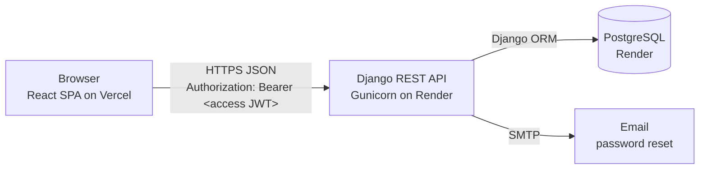
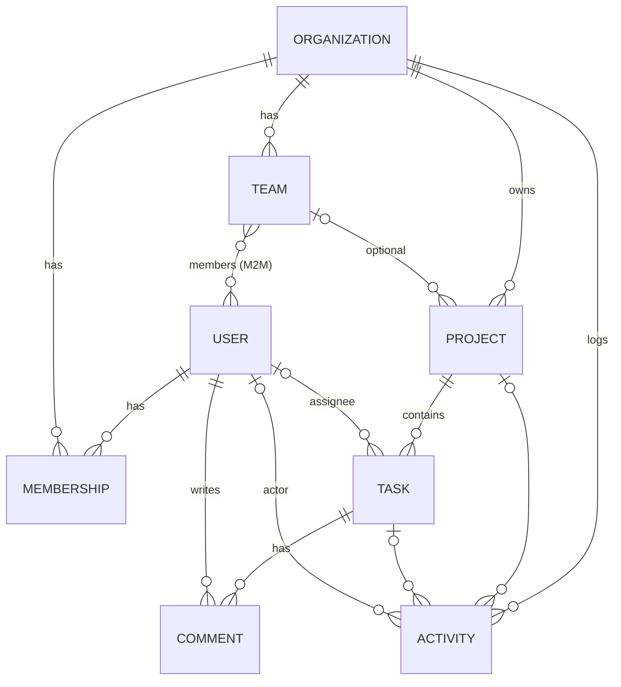

# TeamFlow

A full-stack project management platform where users create organizations, manage projects on Kanban boards, assign tasks, and collaborate with teammates under role-based permissions.

## Overview

Small teams often juggle tasks across chat threads, spreadsheets and sticky notes, which makes it hard to know who is doing what, what is overdue, and how close a project is to done. TeamFlow gives each organization one place to:

- organize people into an organization and teams, with **Owner / Admin / Member** roles,
- plan work as projects with a **To Do → In Progress → Completed** Kanban board,
- assign tasks with deadlines, priorities and descriptions,
- discuss work in task comments, with a full **activity history** of every change,
- see progress at a glance on a **dashboard**.

## Live Demo

- **Frontend (Vercel):** _add your Vercel URL here_
- **API (Render):** _add your Render URL here_ — interactive docs at `/api/docs/`

Demo accounts are created by `python manage.py seed_demo` (password `TeamFlow-demo-2026`):

| Role   | Email                      |
| ------ | -------------------------- |
| Owner  | `owner@demo.teamflow.dev`  |
| Admin  | `admin@demo.teamflow.dev`  |
| Member | `member@demo.teamflow.dev` |

## Screenshots

_Add screenshots to `docs/screenshots/` and reference them here, for example:_

| Dashboard | Kanban board | Task details |
| --------- | ------------ | ------------ |
| `` | `` | `` |

## Features

- **Authentication:** register, log in, log out (refresh-token blacklisting), password reset by email, change password, profile editing.
- **Organizations & teams:** create multiple organizations, switch between them, add members by email, change roles, remove members or leave, and group members into teams.
- **Projects:** create, edit, delete, archive and restore projects. Archived projects are read-only. Projects can be searched and attached to a team.
- **Kanban board:** drag-and-drop tasks between and within the To Do, In Progress and Completed columns. Card order is saved on the server. The board can be filtered by text, assignee and priority.
- **Tasks:** title, description, priority (Low/Medium/High/Urgent), deadline with overdue highlighting, assignee (who must be a member of the organization), and a completion timestamp.
- **Comments & activity history:** threaded discussion per task (authors can edit their comments, and admins can moderate them). An append-only audit log covers the organization, each project and each task.
- **Role-based access:** Owner, Admin and Member rules are enforced on the API and reflected in the UI (see [Security](#security)).
- **Dashboard:** active/archived projects, open and overdue tasks, completion rate, status breakdown, per-project progress bars, "my open tasks", open tasks by priority, and recent activity.
- **API documentation:** OpenAPI 3 schema with Swagger UI and ReDoc.

## Technology Stack

- **Frontend:** React 18, TypeScript, Vite, Tailwind CSS v4, React Router, Axios
- **Backend:** Python, Django 5, Django REST Framework, SimpleJWT, drf-spectacular
- **Database:** PostgreSQL (SQLite fallback for quick local runs)
- **Testing:** Pytest + pytest-django (backend), Vitest + React Testing Library (frontend)
- **Deployment:** Vercel (frontend), Render web service + Render PostgreSQL (backend, `render.yaml` blueprint), WhiteNoise for static files, Gunicorn

## Architecture



- The **React SPA** calls the REST API under `/api/` using Axios (`frontend/src/api/`). The base URL comes from `VITE_API_URL`.
- **Auth:** login returns a short-lived **access token** and a longer-lived **refresh token**, both stored in `localStorage`. An Axios interceptor attaches the access token to each request. On a `401` it refreshes once, sharing one in-flight refresh between parallel requests because refresh tokens rotate, then retries the request. Logging out blacklists the refresh token on the server.
- **Organization context:** the selected organization is kept in React context (`OrgContext`). Each page fetches data scoped to it with `?organization=<id>`.
- **Backend apps:**
  - `accounts`: email-based custom user model and the auth endpoints.
  - `organizations`: organizations, memberships with roles, teams, and the shared permission helpers.
  - `projects`: projects, tasks, comments, the activity log, and the dashboard aggregation.
- **CORS** is restricted to the configured frontend origins, and **WhiteNoise** serves the admin and API-docs static files.

```
TeamFlow/
├── backend/            Django project (teamflow/), apps: accounts, organizations, projects; tests/
├── frontend/           React + TS app: src/api, src/context, src/components, src/pages, src/lib
├── render.yaml         Render blueprint (API + PostgreSQL)
└── docker-compose.yml  Local PostgreSQL
```

## Installation

### Prerequisites

- Python 3.12+
- Node.js 20+
- PostgreSQL 14+ (or Docker, using the included `docker-compose.yml`). If you skip it, the backend falls back to SQLite.

### Backend Setup

1. **Clone the repository.**
   ```bash
   git clone https://github.com/<your-username>/teamflow.git
   cd teamflow/backend
   ```
2. **Create a virtual environment.**
   ```bash
   python -m venv .venv
   source .venv/bin/activate        # Windows: .venv\Scripts\activate
   ```
3. **Install dependencies.**
   ```bash
   pip install -r requirements.txt
   ```
4. **Configure environment variables.** Copy the example file and adjust it. `backend/.env` is loaded automatically.
   ```bash
   cp .env.example .env
   # Start PostgreSQL if you don't have one running:
   docker compose -f ../docker-compose.yml up -d
   ```
   Remove `DATABASE_URL` from `.env` to use SQLite instead.
5. **Run database migrations** (and optionally load demo data).
   ```bash
   python manage.py migrate
   python manage.py seed_demo        # optional: demo org, users, projects, tasks
   python manage.py createsuperuser  # optional: Django admin at /admin/
   ```
6. **Start the backend server.**
   ```bash
   python manage.py runserver        # http://localhost:8000
   ```
   Password-reset emails are printed to this terminal while `EMAIL_BACKEND` is the console backend.

### Frontend Setup

1. **Install dependencies.**
   ```bash
   cd ../frontend
   npm install
   ```
2. **Configure the API URL.**
   ```bash
   cp .env.example .env.local        # VITE_API_URL=http://localhost:8000
   ```
3. **Start the development server.**
   ```bash
   npm run dev                       # http://localhost:5173
   ```

### Deployment

**Backend → Render**

1. Push the repo to GitHub. In Render, choose **New → Blueprint** and select the repo. `render.yaml` creates the PostgreSQL database and the `teamflow-api` web service, which runs `backend/build.sh` to install, collect static files and migrate.
2. After the frontend is deployed, set these on the web service:
   - `FRONTEND_URL=https://<your-app>.vercel.app`
   - `CORS_ALLOWED_ORIGINS=https://<your-app>.vercel.app`
   - `CSRF_TRUSTED_ORIGINS=https://<your-app>.vercel.app`
   - SMTP `EMAIL_*` variables, if you want real reset emails.
3. Optional: run `python manage.py seed_demo` from the Render shell.

**Frontend → Vercel**

1. Import the repo in Vercel and set **Root Directory** to `frontend`. The framework preset is Vite, the build command is `npm run build`, and the output directory is `dist`.
2. Add the environment variable `VITE_API_URL=https://<your-api>.onrender.com`.
3. `frontend/vercel.json` rewrites every route to `index.html`, so deep links such as `/projects/3` work.

## API Documentation

With the backend running:

- **Swagger UI:** <http://localhost:8000/api/docs/>
- **ReDoc:** <http://localhost:8000/api/redoc/>
- **OpenAPI schema:** <http://localhost:8000/api/schema/>

In Swagger, call `POST /api/auth/login/`, copy the `access` token, and click **Authorize**.

| Area          | Endpoints                                                                                                                                                         |
| ------------- | ----------------------------------------------------------------------------------------------------------------------------------------------------------------- |
| Auth          | `POST /api/auth/register/`, `login/`, `refresh/`, `logout/`, `change-password/`, `password-reset/`, `password-reset/confirm/`; `GET/PATCH /api/auth/me/` |
| Organizations | `GET/POST /api/organizations/`, `GET/PATCH/DELETE /api/organizations/{id}/`                                                                                       |
| Members       | `GET /api/memberships/?organization=`, `POST /api/memberships/` (by email), `PATCH/DELETE /api/memberships/{id}/`                                                 |
| Teams         | `GET/POST /api/teams/?organization=`, `GET/PATCH/DELETE /api/teams/{id}/`                                                                                         |
| Projects      | `GET/POST /api/projects/?organization=&status=&search=`, `GET/PATCH/DELETE /api/projects/{id}/`, `POST /api/projects/{id}/archive/`, `.../unarchive/`              |
| Tasks         | `GET/POST /api/tasks/?project=&assignee=me&status=&priority=`, `GET/PATCH/DELETE /api/tasks/{id}/`, `POST /api/tasks/{id}/move/` `{status, position}`             |
| Comments      | `GET/POST /api/comments/?task=`, `PATCH/DELETE /api/comments/{id}/`                                                                                               |
| Activity      | `GET /api/activity/?organization=&project=&task=&limit=`                                                                                                          |
| Dashboard     | `GET /api/dashboard/?organization=`                                                                                                                               |
| Health        | `GET /api/health/`                                                                                                                                                |

## Database Design



| Table            | Purpose and key columns                                                                                                                                                                                                                 |
| ---------------- | --------------------------------------------------------------------------------------------------------------------------------------------------------------------------------------------------------------------------------------- |
| **User**         | Custom user that logs in by `email` (unique, stored lowercase) and has a `full_name`.                                                                                                                                                  |
| **Organization** | `name`, `description`, `created_by`. Its users come through Membership.                                                                                                                                                                 |
| **Membership**   | Join table between User and Organization with a `role` (`owner`/`admin`/`member`). Unique per (organization, user).                                                                                                                    |
| **Team**         | Belongs to an organization; M2M `members` (validated to be organization members). The name is unique per organization.                                                                                                                 |
| **Project**      | Belongs to an organization, with an optional team. Has `status` (`active`/`archived`) and `due_date`. Indexed on (organization, status).                                                                                               |
| **Task**         | Belongs to a project. Has `status`, `priority`, `assignee` (FK User, SET NULL), `due_date`, `position` (order within a column) and `completed_at`. Indexed on (project, status, position) and (assignee, status).                       |
| **Comment**      | Belongs to a task and has an `author` and `body`.                                                                                                                                                                                      |
| **Activity**     | Append-only audit log: `organization`, optional `project`/`task`, `actor`, `verb`, `message`. Project, task and actor links use `SET NULL` so history survives deletions.                                                              |

Deleting an organization cascades to its memberships, teams, projects, tasks, comments and activity. Removing a member unassigns their tasks and takes them off the organization's teams.

## Testing

**Backend:** 39 Pytest tests cover auth flows, role hierarchy, organization isolation, projects, Kanban moves, comments, activity, the dashboard and the seed command.

```bash
cd backend
pytest
```

**Frontend:** 27 Vitest + React Testing Library tests cover login/register/reset flows, route protection, session restore, Kanban rendering, drag-and-drop, keyboard access, read-only boards, board ordering logic, and error formatting.

```bash
cd frontend
npm test            # or: npm run test:watch
npm run typecheck   # TypeScript strict mode
```

## Security

**Authentication**
- JWT via SimpleJWT: short-lived access tokens (30 min by default) and refresh tokens (7 days), with **rotation and blacklisting**, so a used or logged-out refresh token cannot be reused.
- Passwords are hashed with Django's PBKDF2 and checked against Django's password validators (length, common passwords, numeric-only, similarity to user attributes).
- Password reset uses Django's signed, single-use tokens. The request endpoint returns the same response whether or not the email exists, so it can't be used to discover accounts.
- Login, registration and password-reset endpoints are **rate limited** (scoped throttles).

**Authorization (role-based access)**

| Action                                         | Member | Admin | Owner |
| ---------------------------------------------- | :----: | :---: | :---: |
| View organization, projects, tasks, activity   |   ✅   |  ✅   |  ✅   |
| Create/edit/move tasks, comment                |   ✅   |  ✅   |  ✅   |
| Delete a task                                  | own tasks |  ✅   |  ✅   |
| Edit own comments / delete any comment         | own / – | own / ✅ | own / ✅ |
| Create, edit, archive, delete projects         |   –    |  ✅   |  ✅   |
| Manage teams, add/remove members, change roles |   –    | ✅ (not owners) |  ✅   |
| Edit organization settings                     |   –    |  ✅   |  ✅   |
| Grant the owner role, delete the organization  |   –    |   –   |  ✅   |

- Every query is scoped to the organizations the user belongs to. Non-members get **404 instead of 403**, so the API never confirms that a resource exists.
- An organization always keeps at least one owner.
- Archived projects reject every write.

**Validation**
- Serializers check that assignees and team members belong to the organization, that teams belong to the project's organization, and that tasks, comments and teams can't be moved to another organization or project. Blank titles and comments are rejected, and query parameters are type-checked (`400` on bad input).
- In production (`DJANGO_DEBUG=False`): HTTPS redirect, secure cookies, `SECURE_PROXY_SSL_HEADER`, restricted `ALLOWED_HOSTS` and CORS origins. The secret key comes from the environment.

## Future Improvements

- Email invitations for people who don't have an account yet.
- Real-time board updates over WebSockets (Django Channels).
- File attachments on tasks, plus @mentions and notifications in comments.
- Subtasks, labels and saved filters. Calendar and timeline views.
- Pagination and full-text search for large organizations.
- End-to-end tests (Playwright) and a GitHub Actions CI pipeline.
- Store refresh tokens in httpOnly cookies to reduce XSS exposure.

## Author

**Hillary Essien**: _add your GitHub profile URL here, e.g. `https://github.com/<your-username>`_
